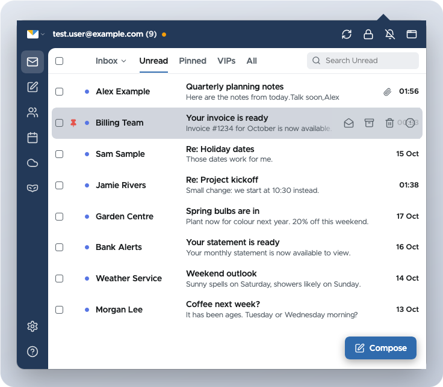

# Super Fastmail

Fastmail in your browser's toolbar. Read and write mail, check your calendar, browse files, look up contacts and make masked email addresses from one dropdown, with desktop notifications when new mail arrives. Think Checker Plus for Gmail, for Fastmail.

Built for Firefox first; Chrome and Edge builds work too. An independent project, not affiliated with Fastmail.

<picture>
  <source media="(prefers-color-scheme: dark)" srcset="docs/tour-dark.avif" type="image/avif">
  <source media="(prefers-color-scheme: dark)" srcset="docs/tour-dark.png">
  <source srcset="docs/tour-light.avif" type="image/avif">
  
</picture>

## What it does

### Mail

- **Inbox at a glance:** tabs for Inbox (or any folder), Unread, Pinned, VIPs and All. Search covers the tab you're on, and partial words match as you type.
- **Conversations:** expand or collapse the whole thread, open attachments, see embedded images. Remote images stay off until you ask for them. HTML email gets a dark mode, with a switch back to its original colours.
- **Tidy up fast:** archive, delete, spam, read or unread, pin, and move to a folder, one at a time or in bulk. Every action can be undone, and Fastmail's keyboard shortcuts work here too.
- **Write:** compose, reply, reply all and forward. You get your identities and signatures, contact suggestions, formatting and attachments. Drafts survive the dropdown closing, and you can save or discard one with a click.
- **Send with a safety net:** undo send (held on Fastmail's side) and schedule send.
- **Stay in touch:** desktop notifications with 17 sounds, Do Not Disturb, live updates by push (with polling as a fallback) and an unread count on the toolbar icon.
- **Vacation response:** turn it on and off from Settings.

### Calendar

- Agenda, week and month views, with each calendar as a chip you can switch on and off.
- Create, edit, move and delete events: double-click a time, drag across a range, or press `c`. Changes made elsewhere are never overwritten.
- Event reminders as desktop notifications.

### Files

- Browse with breadcrumbs, see your quota, download, and preview images.
- Upload with a button or by dropping files in, make folders, rename, move and delete. It asks before deleting.

### And also

- Contacts, and Masked Email (create, enable, disable).
- Settings right in the dropdown: notifications, appearance, vacation response and updates. Help has the keyboard shortcuts and an About page.
- Light and dark themes, comfortable or compact lists, and a pop-out window.

## Install

There are no store listings yet. Download the file for your browser from [Releases](https://github.com/replete/superfastmail/releases):

- **Firefox:** open the `.xpi` from the release in Firefox and confirm. If the release only has `-unsigned.xpi`, that one installs in Firefox Developer Edition, Nightly or LibreWolf with `xpinstall.signatures.required` set to `false` in `about:config`. To try it in any Firefox until the next restart, open `about:debugging` → This Firefox → Load Temporary Add-on and pick the zip.
- **Chrome / Edge:** unzip it, open `chrome://extensions`, turn on Developer mode, choose Load unpacked, and pick the folder.

## Set up

1. In Fastmail, go to **Settings → Privacy & Security → Integrations** and create a **new API token**. A read-only token is enough for reading mail. Tick more scopes to unlock more: write mail, send, contacts, masked email, vacation response.
2. In the extension, open **Settings** (the gear), then **Connection & security**, and paste the token.
3. For Calendar and Files (optional): create a **custom app password with DAV access** in Fastmail and paste it as the Calendar/Files password.
4. Choose how your credentials are protected (below), then Save.

The extension only shows the features your token and password allow.

## Your credentials stay with you

Everything stays in your browser, and the extension only ever talks to Fastmail. Your API token and app password are encrypted together, and you choose what unlocks them:

- **Don't lock:** never asks, but the credentials sit unprotected in your browser profile.
- **Password:** asked once each time the browser starts.
- **Passkey** or **security key:** one touch each time the browser starts, no password. (Firefox on a Mac keeps passkeys in iCloud Keychain.)

While it's locked, nothing is fetched. The lock button in the header locks it again whenever you like and clears everything held in memory.

Email is treated as untrusted. It's cleaned before it's shown, then displayed in a frame that blocks all scripts and network requests (remote images load only when you allow them). The test suite includes a deliberately hostile email to keep it that way.

## Development

```sh
pnpm install
pnpm fake:firefox      # try it in Firefox with made-up mail, calendar and files
pnpm fake:chrome       # the same in Chrome for Testing
pnpm test:fake         # the end-to-end suite against a built-in fake Fastmail
pnpm build:firefox     # → .output/firefox-mv3 (pnpm build for Chrome)
pnpm zip:firefox       # release zips (pnpm zip for Chrome)
pnpm tour              # regenerate the screenshots in docs/ (needs `brew install libavif`)
```

Tests never touch a real account. They run against `scripts/fake-fastmail.mjs` (JMAP, CalDAV and WebDAV) in throwaway browser profiles. Run `pnpm exec puppeteer browsers install firefox` once first.

Built with [WXT](https://wxt.dev) and TypeScript, [tsdav](https://github.com/natelindev/tsdav) and [ical.js](https://github.com/kewisch/ical.js) for CalDAV, and [EventCalendar](https://github.com/vkurko/calendar) for the calendar grid. Notification sounds are from [Pixabay](https://pixabay.com/sound-effects/).

### Releasing

1. Bump `version` in `package.json` and add a matching `## x.y.z` section to [CHANGELOG.md](CHANGELOG.md).
2. Commit, then push a tag `vx.y.z`.

The [release workflow](.github/workflows/release.yml) type-checks, runs the tests, and builds the Firefox and Chrome zips plus the sources zip that add-on review asks for. It then publishes a GitHub release with the changelog section as its notes. "Run workflow" on the Actions page does a dry run without publishing.

## Problems and ideas

[Open an issue](https://github.com/replete/superfastmail/issues).

## Licence

[MIT](LICENSE), except for these bundled third-party parts, which keep their own licences:

- **Notification sounds** (`assets/sounds/*.ogg`) are from [Pixabay](https://pixabay.com/sound-effects/) under the [Pixabay Content License](https://pixabay.com/service/license-summary/). They're free to use as part of this extension but may not be redistributed on their own.
- **Icons** are from [Lucide](https://lucide.dev) under the [ISC licence](https://lucide.dev/license) (notice in [lib/icons.ts](lib/icons.ts)).
- **Metropolis font** ([@fontsource/metropolis](https://fontsource.org/fonts/metropolis)) is public domain (Unlicense).
